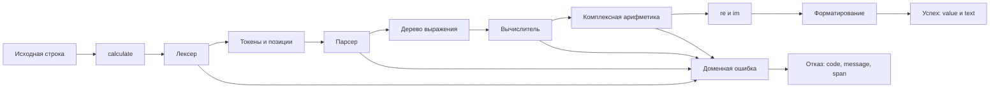

# Implementation Plan: Парсер выражений и комплексная арифметика

**Branch**: `practice_05` | **Date**: 2026-11-02 | **Spec**: [spec.md](spec.md)

**Input**: `specs/001-complex-expression-calculator/spec.md`

**Status**: Plan подготовлен. Tasks, новый код, UI и хранилище ещё не созданы.

## Summary

Расширить калькулятор строковым интерфейсом с приоритетом, унарными знаками,
скобками и комплексными числами. Выделить лексер, парсер AST, комплексную
арифметику, вычислитель и форматирование. Новый фасад `calculate` возвращает
успех или структурированную ошибку по [контракту](contracts/calculation.md).
Все значения нового ядра — `{re, im}`, в том числе вещественные.

История и Undo — следующий этап с заранее записанным
[поведением](contracts/history.md). В первой части нет файловых
побочных эффектов, UI и сервера.

## Technical Context

**Language/Version**: JavaScript, ESM; Node.js >=20.19.0 для окружения
практики. Фактически доступен Node.js v26.10.0.

**Primary Dependencies**: без новых runtime- и test-зависимостей;
официальные шаблоны Spec Kit закреплены коммитом в `.specify/README.md`.

**Storage**: отсутствует в первой части. Будущий JSON не используется
как скрытая зависимость вычисления.

**Testing**: встроенные `node:test`, `node:assert/strict`, команда `npm test`.
Исходный набор: 7 тестов в `tests/calculator.test.js`.

**Target Platform**: локальное Node.js-окружение; ядро не использует I/O
и может позднее импортироваться UI.

**Project Type**: модуль вычисления выражений с публичным фасадом.

**Performance Goals**: пользовательские SLA не заданы. Лексер и парсер
совершают линейный проход, evaluator обходит каждый узел один раз.
Рекурсия зависит от вложенности и длины цепочки унарных знаков.
Бенчмарк и произвольные численные лимиты не добавляются.

**Constraints**: разделение parsing/evaluation, binary64, конечные
компоненты, отсутствие `eval`/`Function`, сохранение baseline.

**Scale/Scope**: одно выражение за вызов; четыре операции, скобки, унарные
знаки и `i`. Весь язык описан в [grammar.md](contracts/grammar.md).

## Constitution Check

Основание: [constitution.md](../../.specify/memory/constitution.md).
Это оценка плана, а не подтверждение работы будущего кода.

| Принцип | До проектирования | После проектирования |
|---|---|---|
| I. Spec до кода | Запрошены только Spec/Plan | Код не меняется; Tasks не создаются |
| II. Разбор отдельно от вычисления | Архитектура согласована | Parser возвращает AST, evaluator принимает AST |
| III. Единый комплексный тип | Модель согласована | Все вычисления возвращают ComplexValue |
| IV. Проверяемость | Известны 7 baseline-тестов | Есть матрица FR → проверки и quickstart |
| V. Границы части | История и UI отложены | Новых зависимостей, I/O и сервера нет |

Нарушений, требующих Complexity Tracking, нет.

## Project Structure

Пути относительно `practices/practice_05`. Документы существуют;
перечисленные новые исходники и тесты — план.

### Documentation (this feature)

```text
.specify/
├── feature.json
├── memory/constitution.md
└── templates/{spec-template.md,plan-template.md}
specs/001-complex-expression-calculator/
├── spec.md
├── plan.md
├── research.md
├── data-model.md
├── quickstart.md
├── checklists/requirements.md
└── contracts/
    ├── grammar.md
    ├── calculation.md
    └── history.md
```

`tasks.md` появится на следующем этапе Spec Kit после просмотра Spec/Plan.

### Source Code

```text
src/
├── calculator.js          # существует; прежний вещественный API
├── errors.js              # план: внутренняя доменная ошибка
├── complex.js             # план: значения и чистая арифметика
├── lexer.js               # план: токены с диапазонами
├── parser.js              # план: AST без арифметики
├── evaluator.js           # план: AST -> ComplexValue
├── format.js              # план: ComplexValue -> text
└── expression.js          # план: публичный calculate
tests/
├── calculator.test.js     # существует; 7 baseline-проверок
├── complex.test.js        # план
├── lexer.test.js          # план
├── parser.test.js         # план
├── evaluator.test.js      # план
├── format.test.js         # план
└── expression.test.js     # план: контракт и сквозные примеры
```

**Structure Decision**: сохранить текущий ESM-проект и runner. Небольшие
модули соответствуют независимым обязанностям; слои сервисов и репозиториев
не нужны. Старый `calculator.js` не заменяется объектным интерфейсом:
новый `calculate` существует отдельно от четырёх прежних функций.

## Phase 0: Research — выполнено

[research.md](research.md) содержит решения и альтернативы: рекурсивный
спуск, конечные комплексные компоненты, масштабирование делителя,
грамматика, ошибки и граница истории. Блокирующих неизвестных нет;
выбранные defaults обозначены как проектные решения.

## Phase 1: Design & Contracts — выполнено

- [data-model.md](data-model.md): ComplexValue, токены, AST и SourceSpan.
- [grammar.md](contracts/grammar.md): полный язык ввода.
- [calculation.md](contracts/calculation.md): результат, ошибки, вывод.
- [history.md](contracts/history.md): только контракт следующего этапа.
- [quickstart.md](quickstart.md): текущий baseline и будущая проверка.



### Границы модулей

1. Lexer сохраняет позиции, выдаёт токены и EOF, отвергает неизвестные
   символы. Числового преобразования и арифметики нет.
2. Parser реализует `sum → product → unary → primary`, строит AST до EOF.
   Group-узел сохраняет скобки и их диапазон. Коэффициенты остаются строками.
3. Complex-слой создаёт конечные значения и реализует чистые операции.
   Умножение учитывает перекрёстные слагаемые и `i² = -1`. Деление сначала
   проверяет точный ноль, затем использует масштабирование из research.
4. Evaluator преобразует литералы в ComplexValue и вычисляет AST слева
   направо. Для переполнения указывает span текущего подвыражения, для
   деления на ноль — span правого операнда, не теряя позиции более ранних ошибок.
5. Formatter занимается только отображением по таблице контракта.
6. Facade проверяет тип/пустоту, вызывает слои, ловит только доменные
   ошибки и формирует ровно одну ветвь CalculationResult.

## Implementation Sequence — следующие шаги

Это порядок работ, а не отметки о выполнении или результат команды Tasks.

### Инкремент 1: вещественные выражения

Определить общий результат/ошибку и ComplexValue с `im = 0`; добавить
разбор чисел, операторов, унарных знаков, скобок и полного ввода.
Подключить evaluator и фасад. При реализации каждого модуля добавлять
его проверки. Поставка: A01–A06, E01–E07, E09–E11 и прежние 7 тестов.
Арифметические функции изначально принимают пару компонент, а не отдельный
вещественный тип. Истории нет.

### Инкремент 2: комплексная арифметика

Добавить литералы `i` и коэффициенты; завершить операции над обеими
компонентами и комплексное форматирование. Контракт результата инкремента 1
не меняется. Проверки: A07–A14, E08, четыре операции без парсера,
комплексный ноль, форматирование и весь регрессионный набор.

### Завершение первой части

Сопоставить фактические результаты с Spec и сохранить вывод проверок.
Проверить отсутствие I/O в вычислительном ядре. Независимое ревью и
приёмка будущей реализации ещё предстоят и не считаются выполненными.

## Verification Strategy

| Требования | Уровень/будущий файл | Доказательство |
|---|---|---|
| FR-001–FR-003 | `lexer.test.js`, `parser.test.js` | Токены, AST приоритетов, скобки, EOF, коэффициент `i` |
| FR-004–FR-005 | `complex.test.js`, `evaluator.test.js` | Формулы и обе компоненты, A07–A14 |
| FR-006–FR-007 | `expression.test.js` | Форма успеха/отказа, пять кодов, spans, E01–E10 |
| FR-008 | `complex.test.js`, `expression.test.js` | Переполнение, `-0`, малый ненулевой делитель |
| FR-009 | `expression.test.js` и diff | Повторяемость, E11, отсутствие I/O в ядре |
| FR-010 | `calculator.test.js`, `expression.test.js` | Прежние 7 тестов, вещественные результаты |
| FR-011 | `format.test.js`, `expression.test.js` | Вся таблица отображения, без лишнего `0i` |

Команда остаётся `npm test`. Проверки пишутся с соответствующей
реализацией, а не откладываются на финал. Погрешность числового сравнения
определена контрактом и не применяется к определению нулевого делителя.

## Risks & Boundaries

- Приоритет/ассоциативность и унарный минус → проверять AST отдельно
  от результата: `8/4/2`, `-(2+3)*4`, `1+-2`.
- Потеря позиции из-за trim/скобок → сохранять строку и Group-span.
- Знаки комплексного деления → проверять известные пары компонент и
  умножение частного на делитель с указанной числовой погрешностью.
- Конечная точность и диапазон → NUMERIC_OVERFLOW, нормализация только
  `-0`; arbitrary precision не обещается.
- Глубокая вложенность зависит от стека среды. Промышленные лимиты не
  заданы; обнаруженное при реализации ограничение нужно отразить
  в контракте до расширения реализации.
- UI, JSON и Undo остаются следующим этапом; I/O API не вводится сейчас.
